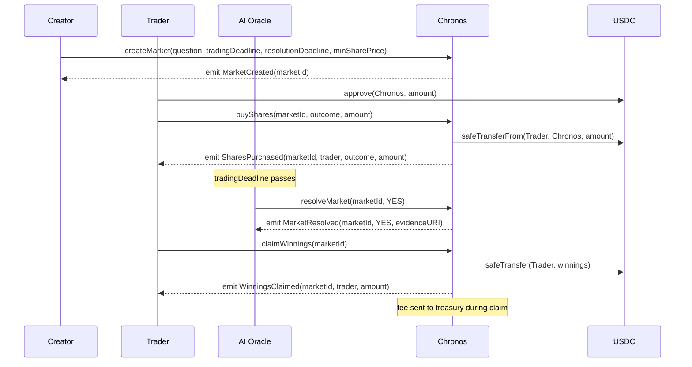

# Chronos — Smart Contract Design Document

## 1. Metadata

| Field | Value |
|---|---|
| **Status** | Draft |
| **Authors** | TBD |
| **Target chain(s)** | Arc Testnet (chain ID 5042002) → Arc Mainnet (chain ID 5042) |
| **Language / Toolchain** | Solidity 0.8.24, Foundry (forge 0.2.x) |
| **OpenZeppelin** | v5.x |
| **Milestone** | v1.0 — Binary Prediction Markets with AI Oracle Resolution |

### Review tracker

- [ ] Design review — TBD
- [ ] Security review — TBD
- [ ] Ops review — TBD
- [ ] Compliance review — TBD

---

## 2. Action Items (living)

_Empty at draft. Fill with bullets as review rounds produce feedback._

---

## 3. Goals / Non-Goals

### Goals

- Allow any address to create a binary (Yes/No) prediction market backed by USDC.
- Allow any address to buy outcome shares (YES or NO) in any open market using USDC.
- Allow an AI agent oracle to submit a verifiable resolution for any market once its resolution window opens.
- Settle resolved markets: distribute the winning pool to YES or NO shareholders pro-rata, minus a protocol fee.
- Allow a human admin/owner to pause the protocol and perform emergency fund rescue for stuck USDC.
- Provide a clean, auditable on-chain record of every market lifecycle event (creation, trade, resolution, settlement, claim).

### Non-Goals

- Multi-outcome (categorical) markets — v1 is binary only.
- Continuous/AMM-style pricing — v1 uses a fixed-odds / proportional share model only.
- Cross-chain market positions or settlement in this version — everything settles on Arc.
- Permissionless oracle registration — there is exactly one authorized AI oracle address per deployment.
- Decentralized governance or token-based voting — not in scope for v1.
- Liquidity provider / market-maker infrastructure beyond the standard entry pool.
- Orderbook or limit-order mechanics.

---

## 4. Requirements

### Functional

1. Any EOA or contract may create a market by specifying a question string, a resolution deadline (Unix timestamp), and a minimum share price (in USDC micro-units, 6 decimals).
2. Any EOA or contract may buy YES or NO shares in an open market; the USDC entry amount is transferred from the buyer to the contract on-chain at purchase time.
3. A market is open for trading until its `tradingDeadline` (set at creation, ≤ `resolutionDeadline`).
4. After `tradingDeadline` passes and before `resolutionDeadline`, the authorized AI oracle may call `resolveMarket(marketId, Outcome)`.
5. After resolution, any winning-side participant may call `claimWinnings(marketId)` to receive their pro-rata share of the total pool minus the protocol fee.
6. The protocol owner may set the fee in basis points (0–500 bps, i.e. 0–5 %).
7. The protocol owner may set a new oracle address.
8. Unclaimed winnings after a configurable grace period (default 180 days post-resolution) may be swept by the protocol to a designated treasury address.
9. If the AI oracle fails to resolve before `resolutionDeadline`, the market enters a `Disputed` state and anyone may trigger a refund path (all participants get their USDC back).

### Security

- SR-1: No path allows a non-oracle to resolve a market.
- SR-2: No path allows resolution outcome to be changed after it is set.
- SR-3: No path allows the same address to claim winnings twice for the same market.
- SR-4: The total USDC paid out (winnings + fees) must equal the total USDC received from traders for that market.
- SR-5: Reentrancy cannot be used to drain the contract's USDC balance or double-claim.
- SR-6: A paused contract rejects all state-changing calls except `claimWinnings` (to allow fund recovery) and owner-only emergency functions.
- SR-7: Integer arithmetic must not overflow; no unchecked blocks touch fund-handling paths.
- SR-8: The oracle address cannot be the zero address.
- SR-9: The fee recipient (treasury) cannot be the zero address.

---

## 5. Terminology & Actors

### Terminology

| Term | Definition |
|---|---|
| **Market** | A binary prediction question with a defined lifetime, two outcome pools (YES and NO), and a resolution process. |
| **Outcome** | Either `YES` (1) or `NO` (2). A third enum value `UNRESOLVED` (0) is the initial state. |
| **Share** | A unit of position in one outcome of a market. 1 share = 1 USDC (6 decimals) staked on that outcome. |
| **Trading deadline** | The timestamp after which no new shares may be purchased. Must be ≤ resolution deadline. |
| **Resolution deadline** | The timestamp by which the oracle must resolve; after it passes without resolution the market can be refunded. |
| **AI Oracle** | An off-chain AI agent that submits evidence and a resolution verdict on-chain. One address per deployment. |
| **Resolution** | The act of the AI oracle calling `resolveMarket` with a `YES` or `NO` outcome. |
| **Settlement / Claim** | The act of a winning participant withdrawing their pro-rata share of the pool. |
| **Protocol fee** | A basis-point fraction of the total pool taken before distributing winnings, sent to the treasury. |
| **Treasury** | The address that receives protocol fees and unclaimed-winnings sweeps. |
| **Grace period** | Days after resolution during which unclaimed winnings remain claimable before the protocol sweeps them. |

### Actors

| Actor | On/Off-chain | Trust level | Capabilities |
|---|---|---|---|
| **Market creator** | On-chain (EOA or contract) | Untrusted | Calls `createMarket`; pays no special fee beyond gas. |
| **Trader** | On-chain (EOA or contract) | Untrusted | Calls `buyShares`; USDC transferred at call time. |
| **AI Oracle** | Off-chain agent, on-chain via its wallet address | Semi-trusted (single authorized address) | Calls `resolveMarket`; cannot move funds. |
| **Protocol owner** | On-chain (multisig recommended) | Trusted | Sets fee, oracle address, treasury, grace period; pauses/unpauses; rescues stuck tokens. |
| **Treasury** | On-chain address | Trusted (receives value) | Passively receives fees and swept winnings. |
| **Refund claimant** | On-chain | Untrusted | Calls `claimRefund` if market enters Disputed state. |

---

## 6. Language / Runtime

- **Language**: Solidity 0.8.24 — chosen for built-in checked arithmetic (no SafeMath wrapper needed), `custom error` support for gas-efficient reverts, and wide tooling compatibility.
- **Toolchain**: Foundry (`forge 0.2.x`). Tests use `forge test`; deployment uses `forge script` (or the Circle Smart Contract Platform deploy tool for Arc Studio).
- **EVM hardfork target**: Shanghai (EIP-3855 `PUSH0` available). Arc EVM tracks Ethereum's EVM version; Shanghai is confirmed supported.
- **Base contracts**: OpenZeppelin Contracts v5.x — specifically:
  - `Ownable2Step` (two-step owner transfer; `renounceOwnership` overridden to revert).
  - `Pausable` (pause/unpause controlled by a separate Pauser role).
  - `ReentrancyGuard` (applied to all fund-touching entry points).
  - `SafeERC20` (for USDC transfers — handles non-standard return-value tokens).

---

## 7. Transaction & Execution Model

All execution is synchronous and atomic on Arc. If any step in a call reverts, all state changes in that call revert. There is no two-phase or async bridge operation in v1.

**Re-entry surface**: The two highest-risk entry points are `buyShares` (pulls USDC from the caller) and `claimWinnings` / `claimRefund` (pushes USDC to the caller). Both follow CEI (Checks-Effects-Interactions):

1. **Check**: validate preconditions (market state, deadline, amount, not already claimed).
2. **Effect**: update contract state (share balances, claimed flags) _before_ the external token transfer.
3. **Interact**: call `IERC20.safeTransfer` / `IERC20.safeTransferFrom` last.

`nonReentrant` from `ReentrancyGuard` is applied to `buyShares`, `claimWinnings`, `claimRefund`, and `sweepUnclaimed` as a defense-in-depth layer.

---

## 8. Chain Standards & Interfaces

- **Token standard consumed**: ERC-20 (USDC at `0x3600000000000000000000000000000000000000` on Arc). Interacted with via `SafeERC20.safeTransferFrom` and `SafeERC20.safeTransfer`. USDC on Arc uses 6 decimals.
- **No ERC standard implemented** by Chronos itself — it is a protocol contract, not a token.
- **No signature verification** in v1 — all oracle resolution is a direct on-chain transaction from the oracle address. EIP-712 + nonce-based off-chain resolution attestations are a v2 consideration.
- **No cross-chain messaging** in v1 — single-chain Arc deployment.

_§8 mapping table_: N/A — Chronos does not port an existing EVM interface to another chain; it is a new contract deployed natively on Arc.

---

## 9. Architecture Overview

### Components

```
┌─────────────────────────────────────────────┐
│            Chronos.sol (main)               │
│  ┌─────────────┐  ┌─────────────────────┐   │
│  │  Market     │  │   Share Ledger       │   │
│  │  Registry   │  │  (yesBal/noBal per  │   │
│  │  (markets[])│  │   address per mkt)   │   │
│  └─────────────┘  └─────────────────────┘   │
│                                             │
│  pausable  │  nonReentrant  │  Ownable2Step │
└─────────────────────────────────────────────┘
         │ USDC (ERC-20)
         ▼
┌──────────────────────────────────┐
│  USDC Token Contract             │
│  0x3600000000000000000000000000  │
│  000000000000000000000000000000  │
└──────────────────────────────────┘

Off-chain AI Oracle ──resolveMarket()──► Chronos.sol
```

### Sequence: full market lifecycle



### Flow of funds

| Step | Who moves what | Invariant |
|---|---|---|
| `buyShares` | Trader → Chronos: `amount` USDC | `markets[id].yesPool + markets[id].noPool` increases by `amount` |
| `claimWinnings` | Chronos → winner: `winnings` USDC; Chronos → treasury: `fee` USDC | `fee + sum(all winnings)` == `totalPool` for that market |
| `claimRefund` | Chronos → refund claimant: their staked amount | `refunded[id][addr]` = true; cumulative refunds ≤ totalPool |
| `sweepUnclaimed` | Chronos → treasury: unclaimed residual | Only after grace period; residual → treasury; market closed |

**Resting-state invariant**: The Chronos contract holds USDC only for unsettled markets. For any fully settled (all winnings claimed or swept) market, the contract's USDC balance attributable to that market is zero.

### Dependencies

- **External contracts**: USDC at `0x3600000000000000000000000000000000000000` (Arc Mainnet + Arc Testnet — same address).
- **Chain assumption**: Arc EVM is atomic and synchronous; no async execution.
- **App assumption**: AI oracle runs off-chain and calls `resolveMarket` before `resolutionDeadline`.

---

## 10. Contract Design

### Roles

| Role | Count / Holder | Permissions | Rationale |
|---|---|---|---|
| `owner` | 1 (multisig recommended) | Set fee bps, set oracle address, set treasury, set grace period, pause/unpause, rescue stuck tokens, trigger sweep | Least-privilege admin; two-step transfer via `Ownable2Step` |
| `oracle` | 1 (AI agent wallet) | Call `resolveMarket` | Separation of oracle key from admin key limits blast radius |
| `pauser` | Owner (same key in v1; dedicated pauser key is a v2 upgrade) | Call `pause()` / `unpause()` | Allows emergency stop without transferring ownership |

> **Note**: A dedicated `pauser` role separate from `owner` is strongly recommended before mainnet; v1 keeps them unified for simplicity and documents the upgrade path.

### Storage layout

```solidity
// --- Enums ---
enum Outcome { UNRESOLVED, YES, NO }
enum MarketState { Open, TradingClosed, Resolved, Refundable, Settled }

// --- Structs ---
struct Market {
    string  question;          // UTF-8 question text
    uint64  tradingDeadline;   // Unix timestamp
    uint64  resolutionDeadline;// Unix timestamp
    uint256 yesPool;           // Total USDC on YES (6-dec)
    uint256 noPool;            // Total USDC on NO  (6-dec)
    uint256 totalPool;         // yesPool + noPool (cached post-trading)
    Outcome outcome;           // UNRESOLVED | YES | NO
    MarketState state;
    uint64  resolvedAt;        // Timestamp of resolution (0 if unresolved)
    string  evidenceURI;       // IPFS/HTTPS URI of AI evidence bundle
    bool    swept;             // True after unclaimed winnings swept to treasury
}

// --- State variables ---
uint256 public marketCount;                     // monotonic counter → market ID
mapping(uint256 => Market) public markets;

// yesShares[marketId][addr] — buyer's YES position in USDC units
mapping(uint256 => mapping(address => uint256)) public yesShares;
// noShares[marketId][addr] — buyer's NO position in USDC units
mapping(uint256 => mapping(address => uint256))  public noShares;

// claimed[marketId][addr] — true after claimWinnings or claimRefund for that addr
mapping(uint256 => mapping(address => bool)) public claimed;

address public oracle;          // AI agent authorized to resolve
address public treasury;        // Receives protocol fees + unclaimed sweeps
uint256 public feeBps;          // Protocol fee in basis points (0–500)
uint256 public gracePeriod;     // Seconds after resolution before sweep allowed (default: 180 days)

IERC20  public immutable usdc;  // USDC token address (set in constructor, immutable)
```

Contract is **not upgradeable in v1** — no proxy, no `__gap`. Upgradeability is deferred to v2 where UUPS + EIP-7201 namespaced storage will be introduced. Migration path: deploy a new Chronos v2 contract; markets are independent and non-transferable between versions; UI is updated to route new markets to v2 while v1 completes settlement.

### Modifiers

| Modifier | Guard enforced |
|---|---|
| `onlyOwner` (inherited) | `msg.sender == owner` |
| `onlyOracle` | `msg.sender == oracle` |
| `whenNotPaused` (inherited) | Protocol is not paused |
| `nonReentrant` (inherited) | Reentrancy guard |
| `marketExists(id)` | `id < marketCount` |
| `inState(id, s)` | `markets[id].state == s` |

### Functions — Write

#### `createMarket`
```
function createMarket(
    string calldata question,
    uint64 tradingDeadline,
    uint64 resolutionDeadline,
    uint256 minSharePrice   // informational; stored but not enforced on-chain in v1
) external whenNotPaused returns (uint256 marketId)
```
- **Caller**: any address.
- **State mutated**: increments `marketCount`; writes `markets[marketId]` with state `Open`.
- **Events**: `MarketCreated(marketId, creator, question, tradingDeadline, resolutionDeadline)`.
- **Revert conditions**: `tradingDeadline >= resolutionDeadline`; `resolutionDeadline <= block.timestamp`; `bytes(question).length == 0`; `bytes(question).length > 1024`.

#### `buyShares`
```
function buyShares(
    uint256 marketId,
    Outcome outcome,     // YES or NO
    uint256 amount       // USDC (6-dec) to stake
) external whenNotPaused nonReentrant marketExists(marketId)
```
- **Caller**: any address.
- **State mutated**: increments `markets[marketId].yesPool` or `noPool` by `amount`; increments `yesShares[marketId][msg.sender]` or `noShares`.
- **Interactions**: `usdc.safeTransferFrom(msg.sender, address(this), amount)`.
- **Events**: `SharesPurchased(marketId, msg.sender, outcome, amount)`.
- **Revert conditions**: `markets[marketId].state != Open`; `block.timestamp >= markets[marketId].tradingDeadline`; `outcome == UNRESOLVED`; `amount == 0`.

#### `closeTrading` (permissionless, time-based)
```
function closeTrading(uint256 marketId) external marketExists(marketId) inState(marketId, Open)
```
- **Caller**: anyone — called automatically or by a keeper/cron once `tradingDeadline` passes.
- **State mutated**: sets `markets[marketId].state = TradingClosed`; caches `totalPool = yesPool + noPool`.
- **Events**: `TradingClosed(marketId, totalPool)`.
- **Revert conditions**: `block.timestamp < markets[marketId].tradingDeadline`.

#### `resolveMarket`
```
function resolveMarket(
    uint256 marketId,
    Outcome outcome,       // YES or NO (not UNRESOLVED)
    string calldata evidenceURI
) external onlyOracle marketExists(marketId) inState(marketId, TradingClosed)
```
- **Caller**: `oracle` only.
- **State mutated**: sets `markets[marketId].outcome`, `.state = Resolved`, `.resolvedAt = block.timestamp`, `.evidenceURI`.
- **Events**: `MarketResolved(marketId, outcome, evidenceURI, block.timestamp)`.
- **Revert conditions**: `outcome == UNRESOLVED`; `block.timestamp > markets[marketId].resolutionDeadline`.

> If the oracle calls `closeTrading` state hasn't been set yet, the market stays in Open. The oracle must call `closeTrading` first (or anyone can call it), then `resolveMarket`. Alternatively, `resolveMarket` can internally call `closeTrading` logic if the trading deadline has passed — implementation choice to document in the final contract.

#### `markRefundable` (permissionless, time-based)
```
function markRefundable(uint256 marketId) external marketExists(marketId)
```
- **Caller**: anyone — triggered when resolution deadline has passed without resolution.
- **State mutated**: sets `markets[marketId].state = Refundable`.
- **Events**: `MarketRefundable(marketId)`.
- **Revert conditions**: `block.timestamp <= markets[marketId].resolutionDeadline`; state is not `Open` or `TradingClosed`.

#### `claimWinnings`
```
function claimWinnings(uint256 marketId) external nonReentrant marketExists(marketId)
```
- **Caller**: any address that holds winning shares.
- **State mutated**: sets `claimed[marketId][msg.sender] = true`.
- **Interactions**: transfers `winnings` + (possibly) `fee` to winner and treasury.
- **Events**: `WinningsClaimed(marketId, msg.sender, winnings)`; `FeePaid(marketId, treasury, fee)`.
- **Pseudocode**:
  ```
  require state == Resolved
  require not claimed[marketId][msg.sender]
  require markets[id].outcome != UNRESOLVED
  winnerShares = (outcome == YES) ? yesShares[id][msg.sender] : noShares[id][msg.sender]
  require winnerShares > 0
  SET claimed[id][msg.sender] = true       ← effect before interaction
  fee = totalPool * feeBps / 10_000
  netPool = totalPool - fee
  winningPool = (outcome == YES) ? yesPool : noPool
  winnings = (winnerShares * netPool) / winningPool
  usdc.safeTransfer(msg.sender, winnings)
  usdc.safeTransfer(treasury, fee * winnerShares / winningPool)  ← proportional fee slice
  emit WinningsClaimed(...)
  ```
  > Fee is split proportionally across claims to avoid the last claimer bearing the full fee: each claimer pays `fee * (their share / winningPool)`.

- **Revert conditions**: market not Resolved; already claimed; no winning shares; zero winnings.

#### `claimRefund`
```
function claimRefund(uint256 marketId) external nonReentrant marketExists(marketId) inState(marketId, Refundable)
```
- **Caller**: any participant (YES or NO buyer).
- **State mutated**: sets `claimed[marketId][msg.sender] = true`.
- **Interactions**: `usdc.safeTransfer(msg.sender, yesShares[id][msg.sender] + noShares[id][msg.sender])`.
- **Events**: `RefundClaimed(marketId, msg.sender, amount)`.
- **Revert conditions**: state not Refundable; already claimed; no shares.

#### `sweepUnclaimed`
```
function sweepUnclaimed(uint256 marketId) external onlyOwner nonReentrant marketExists(marketId)
```
- **Caller**: owner.
- **State mutated**: marks market `Settled`; sets `swept = true`.
- **Interactions**: sweeps remaining USDC balance attributable to market to `treasury`.
- **Events**: `UnclaimedSwept(marketId, treasury, amount)`.
- **Revert conditions**: `block.timestamp < markets[marketId].resolvedAt + gracePeriod`; not Resolved; already swept.

> Computing the exact attributable balance: `totalPool - sum(all claimed winnings) - sum(all claimed fees)`. In practice, tracked as a per-market `settledAmount` accumulator updated on each `claimWinnings`.

#### `setOracle`, `setTreasury`, `setFeeBps`, `setGracePeriod` — owner-only setters

Each validates: non-zero address (for addresses); fee ≤ 500 bps; grace period ≥ 1 day. Emits `OracleUpdated`, `TreasuryUpdated`, `FeeUpdated`, `GracePeriodUpdated`.

#### `pause` / `unpause` — owner-only; inherited from `Pausable`.

#### `rescueTokens`
```
function rescueTokens(address token, address to, uint256 amount) external onlyOwner
```
- Allows owner to recover tokens mistakenly sent to the contract, **excluding USDC** if markets are active. If `token == address(usdc)`, only the amount in excess of the tracked pool total may be rescued (to prevent draining live market funds). Emits `TokensRescued(token, to, amount)`.

### Functions — Read (key; not exhaustive)

- `getMarket(uint256 marketId) returns (Market memory)`
- `getShares(uint256 marketId, address user) returns (uint256 yes, uint256 no)`
- `hasClaimed(uint256 marketId, address user) returns (bool)`
- `computeWinnings(uint256 marketId, address user) returns (uint256 winnings, uint256 feeSlice)` — preview before claim.

### Events

| Event | Parameters | When emitted |
|---|---|---|
| `MarketCreated` | `marketId, creator, question, tradingDeadline, resolutionDeadline` | On `createMarket` |
| `SharesPurchased` | `marketId, buyer, outcome (enum), amount` | On `buyShares` |
| `TradingClosed` | `marketId, totalPool` | On `closeTrading` |
| `MarketResolved` | `marketId, outcome (enum), evidenceURI, timestamp` | On `resolveMarket` |
| `MarketRefundable` | `marketId` | On `markRefundable` |
| `WinningsClaimed` | `marketId, claimant, winnings` | On `claimWinnings` |
| `FeePaid` | `marketId, treasury, amount` | On `claimWinnings` (per claim) |
| `RefundClaimed` | `marketId, claimant, amount` | On `claimRefund` |
| `UnclaimedSwept` | `marketId, treasury, amount` | On `sweepUnclaimed` |
| `OracleUpdated` | `oldOracle, newOracle` | On `setOracle` |
| `TreasuryUpdated` | `oldTreasury, newTreasury` | On `setTreasury` |
| `FeeUpdated` | `oldBps, newBps` | On `setFeeBps` |
| `GracePeriodUpdated` | `oldPeriod, newPeriod` | On `setGracePeriod` |
| `TokensRescued` | `token, to, amount` | On `rescueTokens` |

Index: `marketId` on all market-scoped events; `buyer`/`claimant` on position events.

---

## 11. Specification tables

### 11.1 Principles

1. **Pool conservation**: For any market M, `sum(all USDC in) == sum(all USDC out)` across its lifetime (winnings + fees + refunds + swept residual).
2. **Single resolution**: Once `markets[M].outcome != UNRESOLVED`, it is immutable.
3. **Single claim**: `claimed[M][addr]` transitions from false → true exactly once per address per market.
4. **No free money**: An address with zero shares receives zero winnings and zero refund.
5. **Oracle separation**: Only the `oracle` address advances a market from `TradingClosed` → `Resolved`.

### 11.2 Functionalities

| Functionality | Restriction | Note | Event | Arc Adjustment | Audit Note |
|---|---|---|---|---|---|
| Create market | Anyone, not paused | `tradingDeadline < resolutionDeadline`; deadlines in future | `MarketCreated` | | Verify deadline ordering |
| Buy shares | Anyone, not paused, market Open, before trading deadline | USDC transferred at call time | `SharesPurchased` | USDC is native ERC-20 on Arc (`0x3600…`) | Verify CEI ordering |
| Close trading | Anyone, after trading deadline, state Open | Time-gated; permissionless keeper | `TradingClosed` | | Verify timestamp check |
| Resolve market | Oracle only, state TradingClosed, before resolution deadline | Immutable after set | `MarketResolved` | | SR-1, SR-2 |
| Mark refundable | Anyone, after resolution deadline, state Open/TradingClosed | Oracle missed deadline path | `MarketRefundable` | | Verify timestamp check |
| Claim winnings | Anyone, state Resolved, has winning shares, not claimed | Pro-rata; fee slice per claim | `WinningsClaimed`, `FeePaid` | | SR-3, SR-4, SR-5 |
| Claim refund | Anyone, state Refundable, not claimed | Full stake returned | `RefundClaimed` | | SR-3, SR-5 |
| Sweep unclaimed | Owner only, post grace period | Safety valve for abandoned markets | `UnclaimedSwept` | | Verify grace period |
| Set oracle | Owner only | Non-zero address | `OracleUpdated` | | SR-8 |
| Set treasury | Owner only | Non-zero address | `TreasuryUpdated` | | SR-9 |
| Set fee | Owner only | 0–500 bps | `FeeUpdated` | | |
| Pause / unpause | Owner only | Blocks most state changes | (inherited Pausable events) | | SR-6 |
| Rescue tokens | Owner only | Cannot drain active market USDC | `TokensRescued` | | Verify excess-only check |

---

## 12. Deployment & Initialization

**Constructor** (not upgradeable in v1):
```solidity
constructor(
    address _usdc,
    address _oracle,
    address _treasury,
    uint256 _feeBps,
    uint256 _gracePeriod
)
```
- Sets immutable `usdc`.
- Validates: `_oracle != address(0)`, `_treasury != address(0)`, `_feeBps <= 500`, `_gracePeriod >= 1 days`.
- Calls `Ownable2Step` with `msg.sender`.

**Init runbook (Arc Testnet)**:
1. Deployer wallet funded with Arc Testnet USDC (from Circle faucet) for gas.
2. `forge script` or Circle SCP deploy tool deploys `Chronos` with constructor args:
   - `_usdc`: `0x3600000000000000000000000000000000000000`
   - `_oracle`: AI oracle agent wallet address
   - `_treasury`: protocol treasury address
   - `_feeBps`: `200` (2%) for testnet
   - `_gracePeriod`: `15552000` (180 days in seconds)
3. Verify deployment: `cast call <addr> "oracle()(address)"` confirms oracle address.
4. Owner transfers ownership to multisig (or a testnet equivalent) via `transferOwnership` → multisig accepts via `acceptOwnership`.
5. Record deployed address in `AGENTS.md`.

**Post-deploy minimum balance**: Zero — the contract begins with no USDC; funds enter only when traders buy shares.

---

## 13. Upgradeability

**v1 is not upgradeable.** There is no proxy.

**Migration story for v2**:
- Deploy a new Chronos v2 contract (UUPS proxy, EIP-7201 namespaced storage).
- UI routes new `createMarket` calls to v2.
- v1 remains live for existing market settlement, read-only once all markets close.
- No dual-run period required because markets are self-contained — v1 and v2 never share state.
- Integrators must re-point to the v2 address. Event schema should be backward-compatible to ease indexer migration.

---

## 14. Key Management & Signing

| Key | Role held | Storage recommendation | Blast radius if compromised |
|---|---|---|---|
| Deployer key | Used once at deploy, then discarded | Hot wallet (one-time use only) | Zero post-deploy if ownership is transferred |
| Owner key | Owner admin functions | Cold multisig (2-of-3 minimum) | Can pause protocol, change oracle/treasury, sweep unclaimed funds |
| Oracle key | `resolveMarket` only | Hot wallet controlled by AI agent runtime; rotatable via `setOracle` | Can resolve markets with wrong outcome; cannot move funds directly |
| Treasury address | Receives fees | Cold wallet or protocol contract | Funds sent here cannot be re-routed without owner action |

**No off-chain signing in v1**: All oracle actions are direct on-chain transactions. EIP-712 signed oracle attestations (for cheaper/gasless resolution) are a v2 feature.

---

## 15. Security Considerations

| Vulnerability | Applicable? | Mitigation |
|---|---|---|
| Reentrancy | Yes — `buyShares`, `claimWinnings`, `claimRefund`, `sweepUnclaimed` | CEI ordering throughout; `nonReentrant` on all fund-touching functions |
| Access control | Yes — oracle resolve, owner setters, sweep | `onlyOracle`, `onlyOwner` modifiers; single authorized oracle address; two-step ownership |
| Integer overflow/underflow | Solidity 0.8.24 checked by default | No `unchecked` blocks on fund paths. Basis-point math (`totalPool * feeBps / 10_000`) safe for realistic USDC amounts (max pool < 2^128) |
| Unchecked external call / return | Yes — USDC transfers | `SafeERC20.safeTransferFrom` / `safeTransfer` used throughout |
| Fee-on-transfer / rebasing tokens | USDC is not fee-on-transfer | N/A for USDC; `rescueTokens` uses `safeTransfer` so other tokens are safe too |
| Signature replay | N/A in v1 — no off-chain signatures | Planned for v2 (oracle attestations): will require nonce + deadline + domain separator + chainId |
| Front-running / MEV | Partial — traders can observe pending `resolveMarket` tx and buy winning shares before it lands | `tradingDeadline` must pass before resolution can happen, eliminating last-second front-running; any MEV is bounded by the `tradingDeadline` gap |
| Flash-loan / price manipulation | Not applicable — Chronos uses no AMM pricing or price oracles | Shares are simple pro-rata; flash loans cannot manipulate pool ratios post-tradingDeadline |
| Oracle manipulation | Yes — single AI oracle is a trusted party | Oracle is semi-trusted; owner can rotate oracle address; on-chain evidence URI allows community verification; future v2 multi-oracle dispute resolution |
| Denial of service | Yes — `claimWinnings` iterates nothing (per-address claim); `sweepUnclaimed` is owner-only | Pull-over-push pattern; no loops over unbounded arrays; bounded state writes per call |
| Delegatecall / proxy safety | N/A in v1 (no proxy) | Documented upgrade to UUPS in v2 |
| Timestamp / block dependence | Yes — deadlines use `block.timestamp` | Block timestamps on Arc are accurate to sub-second; ±15 s tolerance is acceptable for hourly/daily deadlines; not used for randomness |
| Approval persistence | USDC approval is pull-based (traders approve Chronos) | Traders approve only the exact amount per `buyShares` call; no persistent max-approval stored in Chronos |
| Centralization risk | Yes — single owner, single oracle | Owner is a multisig (recommendation); oracle is rotatable; pause requires only owner; trust model in §16 covers blast radius |
| Double-claim | Yes — same address claiming twice | `claimed[marketId][addr]` boolean, set before transfer (CEI) |
| Market-pool imbalance | Low — fees applied to total pool, paid per-claim proportionally | Fee-per-claim math prevents the last claimer bearing full fee; `computeWinnings` view allows off-chain verification |

---

## 16. Trust Model & Threat Analysis

| Actor | Worst-case if key compromised | Mitigation | Detection |
|---|---|---|---|
| **Owner key** | Pause all trading, drain unclaimed winnings to a rogue treasury, change oracle to a rogue address, block legitimate claims | Multisig ownership (2-of-3+); timelock (v2 target); `OracleUpdated` and `TreasuryUpdated` events for alerting | Monitor `OracleUpdated`, `TreasuryUpdated`, `Paused` events on-chain; alert on treasury change |
| **Oracle key** | Resolve any `TradingClosed` market with the wrong outcome, giving losing-side funds to wrong claimants | Oracle can only be rotated by owner (multisig); evidence URI on-chain enables community challenge; v2 dispute resolution; re-issuing oracle is a 1-tx owner action | Monitor `MarketResolved` events and compare AI evidence bundles vs. external data sources; alert on unexpected resolutions |
| **Treasury address** | Receives all fee flow; if compromised, fees are lost | Owner can update treasury at any time; treasury compromise does not affect market USDC pools | Monitor treasury address balance; alert on unexpected outflows |
| **Deployer key** | Only used at construction; should be discarded after ownership transfer | Transfer ownership immediately post-deploy | N/A after transfer |

---

## 17. Emergency Response & Circuit Breakers

- **Pause**: Owner calls `pause()`. All `buyShares`, `createMarket`, `closeTrading`, `resolveMarket`, `markRefundable` calls revert. `claimWinnings` and `claimRefund` remain active (users must always be able to withdraw). `sweepUnclaimed` is owner-only and remains active.
- **Oracle rotation**: If the oracle key is compromised, owner calls `setOracle(newAddress)` immediately. Markets in `TradingClosed` awaiting resolution become resolvable only from the new oracle.
- **Treasury update**: If the treasury address is compromised, owner calls `setTreasury(newAddress)`. Future fee flows route to the new address; past-paid fees cannot be recalled.
- **Token rescue**: `rescueTokens(token, to, amount)` recovers mis-sent ERC-20s. USDC rescue is guarded to excess-only to prevent draining live market pools.

**Incident playbook (summary)**:
1. Owner detects anomaly (via monitoring or community report).
2. Owner calls `pause()` immediately via multisig.
3. Assess: oracle compromise → `setOracle`; treasury compromise → `setTreasury`; contract bug → prepare v2 migration.
4. Communicate to users via official channels.
5. Unpause after root cause resolved and new config in place.

---

## 18. Failure Scenarios

### Scenario A — AI oracle never resolves

Oracle calls `resolveMarket` after `resolutionDeadline`. Transaction reverts (deadline check). Anyone calls `markRefundable`. Market enters `Refundable`. All participants call `claimRefund` and receive their exact USDC back. Pool is conserved; no funds lost.

### Scenario B — Partial resolution claim

10 traders all on the YES side, each put in 100 USDC. Oracle resolves YES. 9 of 10 traders claim. 1 trader never claims. After `gracePeriod`, owner calls `sweepUnclaimed`, and the 1 trader's unclaimed winnings go to treasury. Total pool (1000 USDC) = 9 payouts + 1 sweep + fees. Invariant holds.

### Scenario C — Reentrancy attempt on `claimWinnings`

An attacker deploys a contract that re-enters `claimWinnings` from its `receive()` or USDC transfer callback. Blocked by: (1) `nonReentrant` reverts the reentrant call; (2) `claimed[id][attacker]` is set to `true` before the transfer, so even if reentrancy guard were absent, the check would fail. Double defense-in-depth.

### Scenario D — Owner sets fee to 0 after a market resolves

Markets store the fee at claim time as `feeBps` from storage. Fee is read live at `claimWinnings` time. If owner sets fee to 0, all future claims pay no fee. Pool math still conserves: net pool = total pool; winnings cover the full winning pool. No underflow possible.

### Scenario E — Rogue oracle resolves a market before trading deadline

Blocked: `resolveMarket` requires state == `TradingClosed`. State transitions to `TradingClosed` only after `block.timestamp >= tradingDeadline`. So the oracle cannot resolve a market while trading is open.

---

## 19. Priorities & Tradeoffs

| Decision | Tradeoff | Rationale |
|---|---|---|
| Single authorized oracle (not multi-oracle) | Centralization risk; single point of failure for resolution | Simplicity for v1; faster time to market; oracle is rotatable; v2 adds dispute layer |
| Pull-based winnings claim (not auto-distribute) | Requires winner action; unclaimed funds exist | Avoids iterating over all participants (unbounded gas); standard DeFi pattern |
| Fee split proportionally per claim (not lump sum) | Slightly more complex math per claim | Avoids last-claimer bearing full fee burden; gas-bounded per call |
| Binary markets only (not multi-outcome) | Limited expressiveness | Simpler storage; simpler oracle resolution; lower audit surface; multi-outcome in v2 |
| Not upgradeable in v1 | Migration required for v2 | Eliminates proxy risk, storage layout bugs, and `delegatecall` attack surface for the first version |
| `tradingDeadline` < `resolutionDeadline` (distinct timestamps) | Adds complexity vs. single deadline | Allows oracle time to gather evidence after trading closes without time pressure |
| Fee applied to total pool (not just winnings side) | Losers effectively also contribute to protocol fee (already lost) | Standard prediction market fee model; simpler accounting |

**Rejected alternatives**:
- AMM-style pricing: introduces impermanent loss, LP complexity, and price-oracle risk — deferred to v3.
- Multi-oracle quorum: adds complexity and coordination cost — scoped to v2 dispute resolution.
- ERC-1155 share tokens (tradeable positions): adds secondary market support but increases contract surface and audit cost — v2 consideration.

---

## 20. Testing Strategy

**Target coverage**: ≥ 90% branch coverage measured by `forge coverage`.

### Unit tests (Foundry)

- `createMarket`: valid params, invalid params (past deadline, inverted deadlines, empty question, too-long question).
- `buyShares`: valid buy, buy after trading deadline, buy on closed/resolved market, buy with zero amount, USDC transfer failure.
- `closeTrading`: before deadline (reverts), after deadline, idempotent second call (reverts — already TradingClosed).
- `resolveMarket`: valid resolution, non-oracle caller (reverts), wrong state (reverts), post-deadline (reverts), double-resolve (reverts).
- `markRefundable`: before deadline (reverts), after deadline, wrong state (reverts).
- `claimWinnings`: winning claim, losing side (reverts), double-claim (reverts), unresolved (reverts), fee math.
- `claimRefund`: valid refund, double-refund (reverts), non-refundable state (reverts).
- `sweepUnclaimed`: before grace period (reverts), valid sweep, already swept (reverts).
- Admin setters: valid, zero-address (reverts), fee > 500 bps (reverts).
- Pause: blocks trading and creation, allows claims.
- `rescueTokens`: excess USDC only, other tokens freely.

### Fuzz / invariant tests (Foundry)

- **Invariant**: `sum(yesPool[i] + noPool[i] for all markets)` == `usdc.balanceOf(Chronos)` minus fees already paid.
- **Fuzz**: `buyShares` with random amounts and outcomes; `claimWinnings` with random orderings; `sweepUnclaimed` at random times.

### Integration tests

- Full lifecycle: create → buy YES/NO → close → resolve YES → claim all → sweep residual → verify balance zero.
- Refund lifecycle: create → buy → miss resolution deadline → mark refundable → all claim refund → verify balance zero.
- Reentrancy: deploy attacker contract; verify no double-claim possible.

**Run suite**:
```bash
forge test -vvv
forge coverage --report summary
```

**Static analysis**: `slither contracts/Chronos.sol` — fix all High and Medium findings before deploy.

**Merge gate**: all unit + fuzz tests pass; coverage ≥ 90% branch; Slither clean at High/Medium.

---

## 21. Third-party libraries

| Library | Version | Dependency? | Why | Security-reviewed? |
|---|---|---|---|---|
| OpenZeppelin Contracts | v5.x | Added via `forge install` | `Ownable2Step`, `Pausable`, `ReentrancyGuard`, `SafeERC20` — audited, battle-tested | Yes (OZ internal + multiple community audits) |
| Foundry (forge, cast) | 0.2.x | Pre-installed | Testing + deployment toolchain | N/A (tooling, not a contract dependency) |

No other third-party contracts are imported.

---

## 22. Monitoring & Alerting

| Event / Metric | Threshold | Severity | Playbook |
|---|---|---|---|
| `MarketResolved` with unexpected outcome | Any resolution not matching AI evidence bundle | High | Compare `evidenceURI` content with external data; owner can rotate oracle and pause |
| `OracleUpdated` | Any change | High | Verify owner authorized the change; confirm new oracle key is secure |
| `TreasuryUpdated` | Any change | High | Verify change was intentional; check no owner compromise |
| `Paused` | Any | High | Confirm legitimate emergency; prepare comms |
| `MarketRefundable` | Any market reaching this state | Medium | Confirm oracle was offline, not compromised |
| USDC balance of Chronos | Balance > sum of tracked pools (anomaly) | Medium | Investigate; may be a mis-sent token to rescue |
| Oracle wallet USDC balance | < 1 USDC (insufficient for gas) | Low | Top up oracle wallet; Arc gas is USDC |

---

## 23. Cross-Functional Stakeholders

| Stakeholder | What they own |
|---|---|
| Smart contract engineer | Chronos.sol implementation, tests, Foundry scripts |
| AI oracle team | Off-chain agent runtime, evidence bundle format, `resolveMarket` call logic |
| Frontend team | React/wagmi integration, market creation and trading UI, claim flows |
| Security reviewer | Full audit of Chronos.sol before mainnet |
| Ops / DevOps | Oracle wallet monitoring, contract deployment runbook, incident response |
| Legal / Compliance | Prediction market regulatory assessment per target jurisdictions |

---

## 24. Message Encoding

N/A — v1 is single-chain; no cross-chain message passing. A future cross-chain version using CCTP or Circle Gateway will add this section.

---

## 25. Types & Enums

```solidity
enum Outcome {
    UNRESOLVED, // 0 — initial state
    YES,        // 1 — the predicted event occurred
    NO          // 2 — the predicted event did not occur
}

enum MarketState {
    Open,           // 0 — trading live
    TradingClosed,  // 1 — past tradingDeadline, awaiting oracle
    Resolved,       // 2 — oracle resolved; claims open
    Refundable,     // 3 — oracle missed deadline; refunds open
    Settled         // 4 — all funds disbursed or swept
}
```

---

## 26. Common Patterns / Worked Examples

### Example A — End-to-end YES win

**Setup**: Market "Will BTC > $100k by 2026-12-31?" created with `tradingDeadline = T`, `resolutionDeadline = T+7days`. Alice buys 200 USDC YES, Bob buys 800 USDC NO. `feeBps = 200` (2%).

1. Alice: `approve(Chronos, 200)` → `buyShares(0, YES, 200)` → `yesPool = 200`, `noPool = 0`.
2. Bob: `approve(Chronos, 800)` → `buyShares(0, NO, 800)` → `noPool = 800`.
3. Keeper at `T+1`: `closeTrading(0)` → `totalPool = 1000`, state = TradingClosed.
4. AI Oracle at `T+3`: `resolveMarket(0, YES, "ipfs://Qm...")` → state = Resolved.
5. Alice: `claimWinnings(0)`:
   - `fee = 1000 * 200 / 10000 = 20 USDC`
   - `netPool = 980 USDC`
   - `winningPool = 200 (yesPool)`
   - `aliceWinnings = (200 / 200) * 980 = 980 USDC`
   - `aliceFeeSlice = 20 * (200 / 200) = 20 USDC` → treasury
   - Alice receives **980 USDC**; treasury receives **20 USDC**.
6. Bob: `claimWinnings(0)` → reverts: Bob is on losing side (noShares, but outcome is YES).

**Total out**: Alice 980 + treasury 20 = 1000 USDC = total in. Invariant holds.

### Example B — Oracle miss → full refund

**Setup**: Same market, but oracle never calls `resolveMarket`.

1. At `resolutionDeadline + 1 second`: Anyone calls `markRefundable(0)` → state = Refundable.
2. Alice: `claimRefund(0)` → receives 200 USDC (her original stake).
3. Bob: `claimRefund(0)` → receives 800 USDC (his original stake).
4. Contract USDC balance for this market: 0. Invariant holds.
